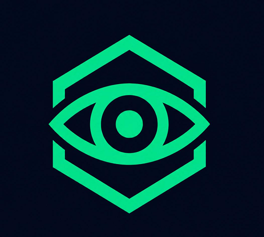
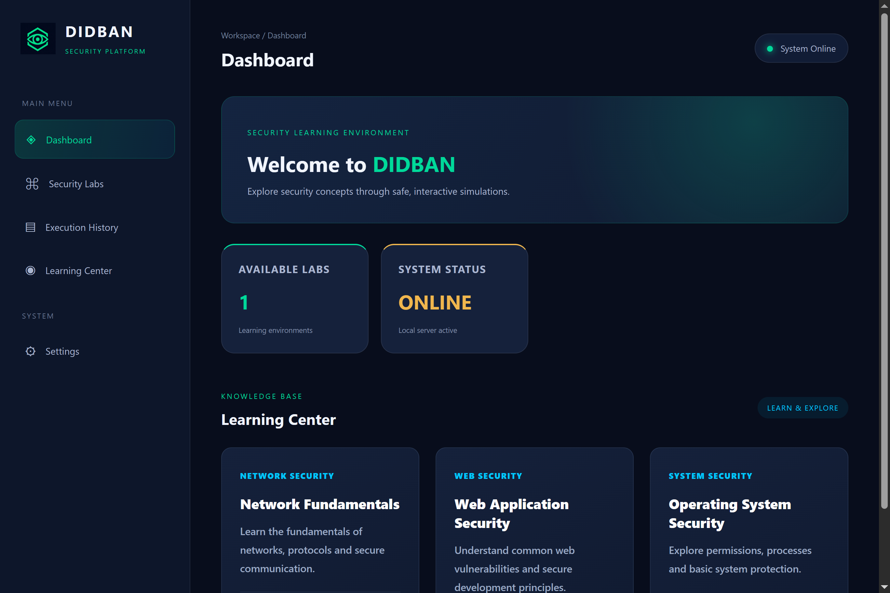
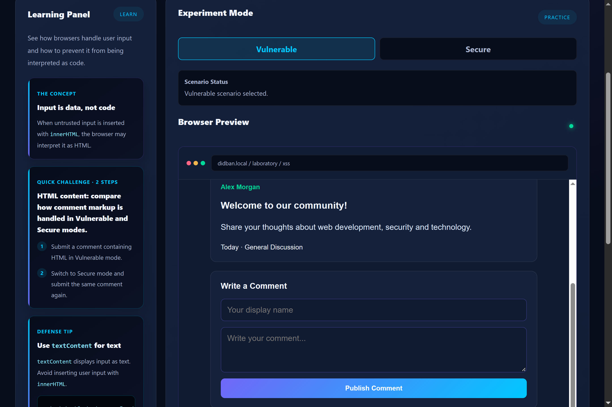

  

  <h1>Didban</h1>

  
Local Cybersecurity Learning Platform

## About Didban

Didban is a local web-based cybersecurity learning platform designed to provide an interactive environment for learning and experimenting with web application security vulnerabilities.

The platform provides practical security laboratories, interactive demonstrations, and educational exercises that help users understand common web vulnerabilities and how they behave.

Didban runs locally on your system, providing a controlled environment for security education and experimentation without requiring an external server.

## Installation

Didban is distributed as an installer package.

### Installation Steps

1. Download the latest Didban installer from the [Releases](../../releases) section.
2. Run the installer executable.
3. Follow the installation wizard instructions.
4. Once the installation is complete, launch Didban using `Didban.exe`.
5. Open the local web interface to access the dashboard and available laboratories.

## XSS Laboratory

The XSS (Cross-Site Scripting) Laboratory is one of the main learning modules in Didban.

It provides an interactive environment for understanding how XSS vulnerabilities work through three difficulty levels: Easy, Normal, and Hard.

Each level introduces different concepts and input-handling scenarios.

### 1. Easy Level

The Easy level introduces the fundamentals of Cross-Site Scripting.

Users can experiment with basic input fields and observe how unsanitized user input can affect browser rendering and execution behavior.

**Focus:**
- Basic XSS concepts.
- Input handling and output rendering.
- Understanding unsafe input processing.
- Observing browser-side behavior.

**Supported Inputs:**
- ["<textarea id="comment-text" placeholder="Write your comment..." maxlength="500" required=""></textarea>"]

### 2. Normal Level

The Normal level introduces more advanced XSS scenarios and demonstrates how vulnerabilities can affect session-related security.

This level includes demonstrations related to cookie and session security, helping users understand the risks associated with improper handling of sensitive browser data.

**Focus:**
- More advanced input-handling scenarios.
- XSS behavior in different application contexts.
- Cookie and session security concepts.
- Understanding the relationship between XSS and session compromise.

**Supported Inputs:**
- input section of name in the comments

### 3. Hard Level

The Hard level focuses on Cookie Hijacking concepts through a controlled demonstration.

This laboratory simulates how an XSS vulnerability could potentially expose session-related information and demonstrates the security implications of cookie theft.

**Focus:**
- Cookie Hijacking concepts.
- Session security awareness.
- Understanding the risks of exposed cookies.
- Observing simulated session-compromise scenarios.

**Important Security Note:**

The Hard level operates entirely within an isolated laboratory environment. Cookie Hijacking is demonstrated through a controlled simulation, without targeting real users, accessing external sessions, or stealing actual browser cookies.

The purpose is strictly educational and focused on understanding web security risks.

## Future Development

Didban is an evolving cybersecurity learning platform.

Future versions will introduce additional security laboratories, covering more web application vulnerabilities and cybersecurity concepts.

Planned improvements include:

- Additional interactive security laboratories.
- More vulnerability simulations.
- Expanded learning materials.
- New practical security exercises.
- Improvements to the user interface and learning experience.

## Project Goals

Didban aims to make cybersecurity education more interactive and accessible by combining theoretical concepts with practical, isolated laboratory environments.

## License

This project is licensed under the MIT License. See the [LICENSE](LICENSE) file for details.
